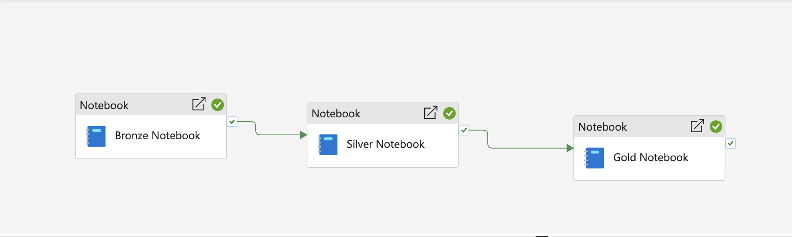

# Worldwide Earthquake Analytics on Microsoft Fabric

An end-to-end data engineering and analytics project on **Microsoft Fabric**. It pulls live earthquake events from the **USGS API**, refines them through a **medallion (Bronze → Silver → Gold)** Lakehouse using PySpark notebooks, serves them to an interactive **Power BI** map report, and refreshes daily through a **Data Factory** pipeline.


## 📌 Project Overview

The solution retrieves worldwide earthquake events from the USGS Earthquake API, processes and enriches the data using PySpark notebooks within Microsoft Fabric, stores curated datasets in Delta Lake tables, and visualizes insights through an interactive Power BI dashboard.

The entire workflow is orchestrated using Microsoft Fabric Data Factory and can be scheduled to run automatically on a daily basis.


```
USGS API → Bronze (raw JSON) → Silver (Delta) → Gold (Delta) → Power BI
                         └──────── Data Factory daily pipeline ────────┘
```


## 🚀 Key Features
Live earthquake data ingestion from the USGS API
Medallion Architecture (Bronze, Silver, Gold)
Fabric Lakehouse storage
Delta Lake tables for analytics
Data transformation using PySpark
Country enrichment using geospatial lookups
Interactive Power BI dashboard
ArcGIS map visualization
Scheduled orchestration using Fabric Data Factory
SQL-based validation queries


## 🛠️ Technologies Used

- Microsoft Fabric
- Lakehouse
- Data Engineering Notebooks
- Data Factory
- SQL Analytics Endpoint
- Semantic Models
- Environments
- Data Engineering
- PySpark
- Delta Lake
- Python
- REST APIs
- Analytics & Reporting
- Power BI
- ArcGIS for Power BI
- SQL


## 📊 Dashboard Features

The Power BI dashboard provides:

Worldwide earthquake distribution map
Significance classification (Low, Moderate, High)
Date range filtering
Interactive slicers
Event count KPI
Maximum significance KPI
Dynamic ArcGIS mapping experience


Pipeline run, all three notebook activities succeeded in sequence:




## What it does

| Layer | Notebook | Output |
|---|---|---|
| Bronze | `01_bronze_earthquake.py` | Raw GeoJSON features saved as `YYYY-MM-DD_earthquake_data.json` in Lakehouse Files |
| Silver | `02_silver_earthquake.py` | Flattened, typed Delta table `earthquake_events_silver` (Unix ms converted to UTC timestamps) |
| Gold | `03_gold_earthquake.py` | `earthquake_events_gold` with approximate `country_code` and `sig_class` (Low / Moderate / High) |
| Report | Power BI | Map, date and intensity slicers, KPI cards |
| Orchestration | Data Factory | Bronze → Silver → Gold notebook activities on a daily schedule |

**Significance classes:** `< 100` Low, `100–499` Moderate, `≥ 500` High.


## Repository layout

```
notebooks/    PySpark notebooks (Bronze, Silver, Gold) exported as .py
sql/          Validation queries for the SQL analytics endpoint
docs/         Pipeline setup, Power BI build notes, design decisions
docs/images/  Screenshots
```


## 📈 Business Value
This solution demonstrates how modern Microsoft Fabric capabilities can be leveraged to build scalable analytical platforms.

The architecture can easily be adapted for:

Weather monitoring
IoT analytics
Financial event tracking
Social media analytics
Public sector reporting
Real-time operational monitoring


## 🎯 Skills Demonstrated

- Data Engineering
- Microsoft Fabric
- Medallion Architecture
- PySpark
- ETL Design
- Delta Lake
- Data Factory Pipelines
- API Integration
- Data Modelling
- SQL Analytics
- Power BI Development
- Data Visualization
- Geospatial Analytics
- Pipeline Automation


## 🔍 Data Source
USGS Earthquake Catalog API

https://earthquake.usgs.gov/fdsnws/event/1/

Data courtesy of the United States Geological Survey (USGS).


## 🚧 Future Enhancements

Delta MERGE implementation for idempotent loads
Data quality validation framework
Automated monitoring and alerting
Real-time streaming integration
Advanced geospatial enrichment
Historical trend analysis
CI/CD deployment pipelines
Fabric Real-Time Intelligence integration


## License

MIT, see [LICENSE](LICENSE).
