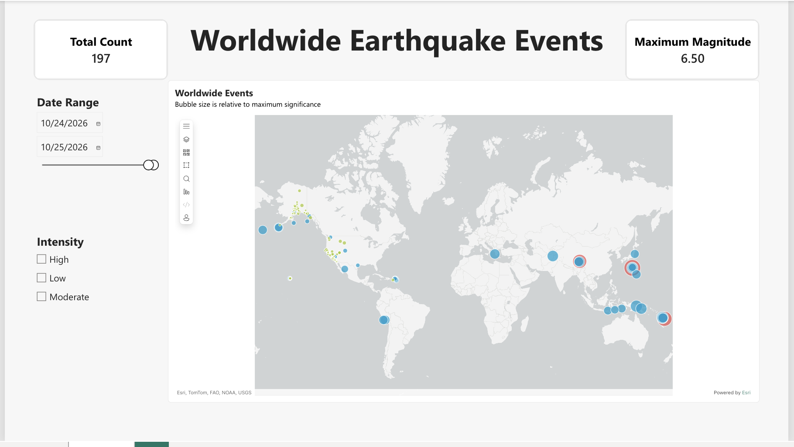

# Power BI report

Source: `earthquake_events_gold` via semantic model `Earthquake_Semantic_Model`. Report name: `Worldwide Earthquake Events`.

## Visuals

| Visual | Setup |
|---|---|
| Map (ArcGIS) | Location: `country_code` · Bubble size: Maximum of `significance` · Legend: `sig_class` · Tooltip: Count of `id` |
| Date range slicer | `time`, Between |
| Intensity slicer | `sig_class`, Tile |
| KPI card: Total count | Count of `id` |
| KPI card: Maximum magnitude | Maximum of `magnitude` |

Map title: *Worldwide Events*. Subtitle: *Bubble size is relative to maximum significance.*

## Notes

- Bubble size reflects **maximum significance per country**, not event count.
- If the map visual is missing, enable ArcGIS for Power BI in settings, or ask a tenant admin to enable map visuals.
- Keep the model to the single Gold table; no relationships are needed.

